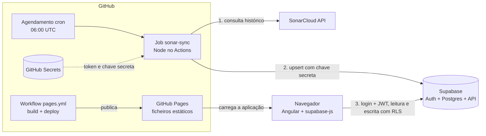
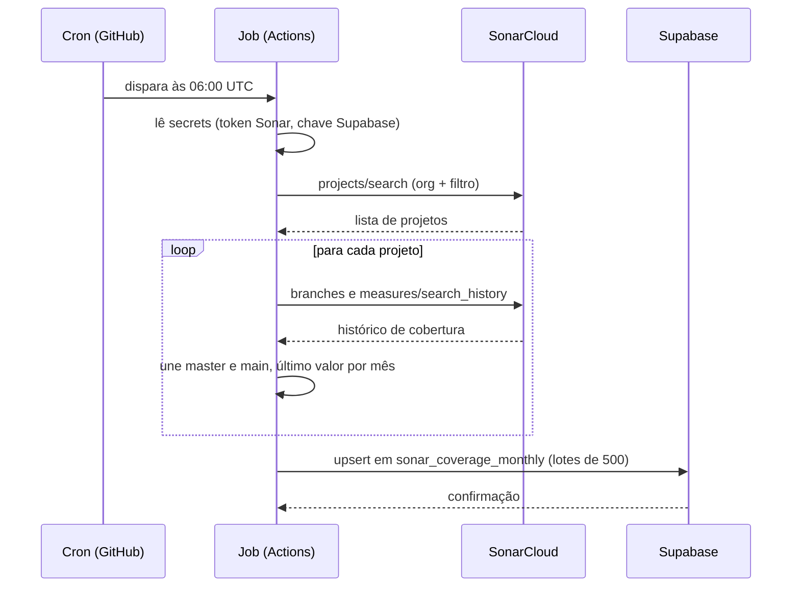
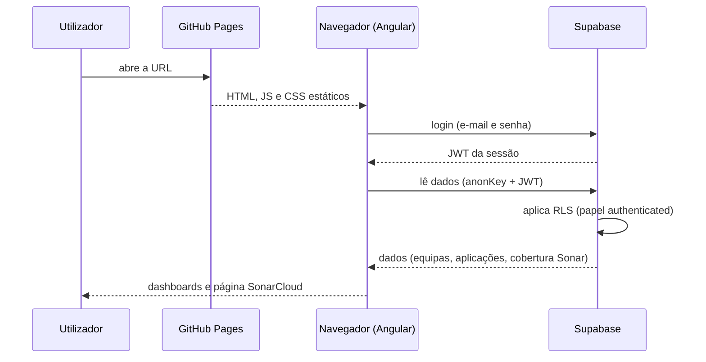

# Fluxo da aplicação: UI, Supabase, SonarCloud e GitHub Actions

## Visão geral

## Os dois ciclos independentes

### A. Alimentação dos dados (diária, sem utilizador)

### B. Utilização da aplicação (quando alguém abre a página)

## Quem tem acesso a quê

| Componente | Fala com | Credencial |
|---|---|---|
| Navegador | Supabase | `anonKey` pública + JWT do login |
| Navegador | SonarCloud | Nunca fala |
| Job (Actions) | SonarCloud | `SONAR_TOKEN` (GitHub Secret) |
| Job (Actions) | Supabase | `SUPABASE_SERVICE_ROLE_KEY` (GitHub Secret) |
| Supabase | SonarCloud | Nunca fala |
| Pages | Ninguém | Só serve ficheiros estáticos |

## Publicação da aplicação

Um push no `main` dispara o workflow `pages.yml`: instala dependências, faz o build do Angular e publica os ficheiros em GitHub Pages. Isso não toca em dados e não usa os secrets do Sonar ou do Supabase.

## Pontos-chave

- **Não há servidor próprio.** O Supabase faz de backend de dados e autenticação, e o GitHub Actions faz de "servidor" do job agendado.
- **A página SonarCloud só mostra o que o job já gravou.** Se o job falhar, a página mostra os dados da última execução bem-sucedida.
- **Os dois ciclos só se encontram na tabela** `sonar_coverage_monthly`: o job escreve, a UI lê.
- **O job grava sempre.** Ele envia o histórico completo e o Supabase faz upsert por `(project_key, month)`: insere o que é novo e atualiza o que já existe.
- **A segurança está no banco (RLS + JWT),** não na interface. A `anonKey` pública no repositório não dá acesso a dados sem login.

## Proteção das chaves e do acesso

Repositório público: nada que dê acesso privilegiado pode estar no código. As medidas em vigor:

### Separação das credenciais

| Credencial | Visibilidade | Onde fica |
|---|---|---|
| `anonKey` (`sb_publishable_...`) | Pública por desenho | Ficheiros de ambiente e bundle |
| `SUPABASE_SERVICE_ROLE_KEY` (`sb_secret_...`) | Secreta, ignora o RLS | GitHub Secrets e `.env` local |
| `SONAR_TOKEN` | Secreto | GitHub Secrets e `.env` local |

- A chave secreta e o token do Sonar **nunca** entram no código nem no bundle publicado. O navegador só conhece a `anonKey`.
- O `.env` local está no `.gitignore` (`.env`, `.env.local`, `.env.*.local`). O `.env.example` só documenta os nomes das variáveis, sem valores.
- Os workflows só referenciam os secrets (`${{ secrets.NOME }}`). O GitHub injeta o valor em tempo de execução, não o mostra na interface e mascara-o nos logs.
- Pull requests vindos de forks não recebem secrets.

### Banco de dados (Supabase)

- **RLS ativo em todas as tabelas**, com políticas só para o papel `authenticated`. O papel `anon` não lê nem escreve nada.
- **Políticas anónimas de desenvolvimento removidas** (`dev-anon-policies.sql` está marcado como já aplicado e não deve voltar a ser executado). A remoção foi verificada: pedidos só com a `anonKey` recebem vazio ou erro de permissão.
- **Registo aberto desativado** (`disable_signup=true`): só entra quem for convidado por um administrador.
- A tabela `sonar_coverage_monthly` é de **só leitura** para utilizadores autenticados. Só o job escreve, com a chave secreta.
- A view `sonar_projects` usa `security_invoker`, para respeitar o RLS de quem consulta.

### GitHub Actions

- `permissions: contents: read` nos dois workflows: o token do workflow não consegue alterar o repositório.
- O job do Sonar só corre pelo agendamento ou por disparo manual (`workflow_dispatch`), nunca por pull request.
- Instalação com `npm ci --ignore-scripts`, para que scripts de dependências não executem durante o build.
- **Logs silenciosos em CI:** quando corre no GitHub Actions, o job não imprime nomes de projetos nem percentagens, porque os logs de um repositório público são visíveis a qualquer pessoa.
- O `package-lock.json` não é alterado manualmente, para manter a instalação reprodutível.

### Verificações feitas

- Sem segredos em ficheiros, no histórico do Git nem no bundle publicado.
- Acesso anónimo à API bloqueado (testado).

### Boas práticas em aberto

- **Rotacionar** a chave secreta do Supabase e o token do Sonar se tiverem sido expostos fora destes sistemas (por exemplo, coladas num chat ou num ecrã partilhado). Depois de gerar os novos valores, atualize os GitHub Secrets e o `.env`, e revogue os antigos.
- Convidar apenas pessoas de confiança: as tabelas de negócio dão acesso total (leitura e escrita) a qualquer utilizador autenticado.
- Conceder permissão de escrita no repositório só a quem precisa, porque quem altera um workflow pode, em teoria, usar os secrets.
