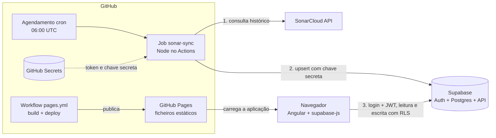
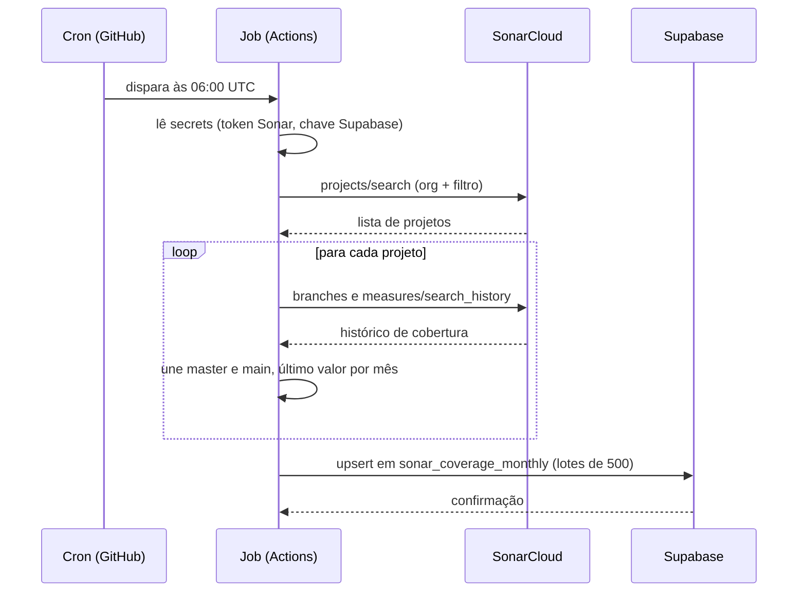
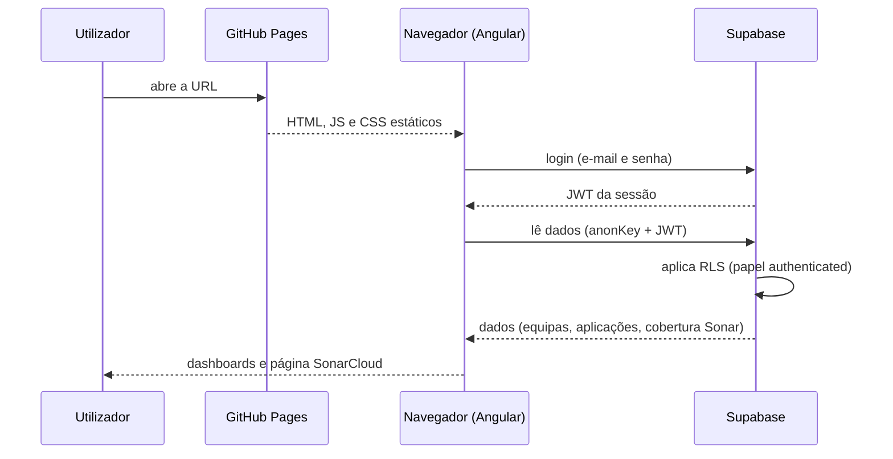

# Fluxo da aplicação: UI, Supabase, SonarCloud e GitHub Actions

## Visão geral

## Os dois ciclos independentes

### A. Alimentação dos dados (diária, sem utilizador)

### B. Utilização da aplicação (quando alguém abre a página)

## Quem tem acesso a quê

| Componente | Fala com | Credencial |
|---|---|---|
| Navegador | Supabase | `anonKey` pública + JWT do login |
| Navegador | SonarCloud | Nunca fala |
| Job (Actions) | SonarCloud | `SONAR_TOKEN` (GitHub Secret) |
| Job (Actions) | Supabase | `SUPABASE_SERVICE_ROLE_KEY` (GitHub Secret) |
| Supabase | SonarCloud | Nunca fala |
| Pages | Ninguém | Só serve ficheiros estáticos |

## Publicação da aplicação

Um push no `main` dispara o workflow `pages.yml`: instala dependências, faz o build do Angular e publica os ficheiros em GitHub Pages. Isso não toca em dados e não usa os secrets do Sonar ou do Supabase.

## Pontos-chave

- **Não há servidor próprio.** O Supabase faz de backend de dados e autenticação, e o GitHub Actions faz de "servidor" do job agendado.
- **A página SonarCloud só mostra o que o job já gravou.** Se o job falhar, a página mostra os dados da última execução bem-sucedida.
- **Os dois ciclos só se encontram na tabela** `sonar_coverage_monthly`: o job escreve, a UI lê.
- **O job grava sempre.** Ele envia o histórico completo e o Supabase faz upsert por `(project_key, month)`: insere o que é novo e atualiza o que já existe.
- **A segurança está no banco (RLS + JWT),** não na interface. A `anonKey` pública no repositório não dá acesso a dados sem login.
